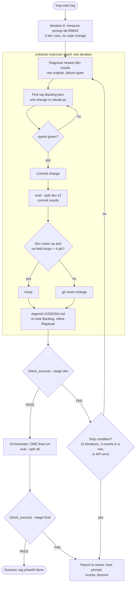

# Handoff: Extractor Improvement Loop

**For:** the Claude Code session that runs the loop (the "orchestrator"), and the human owner reviewing it.
**Repo:** `~/Documents/deal-requirements-board`, branch `main`. The loop starts at tag `loop-start`.
**Goal:** finish roadmap Phase 5. Make the Claude extractor beat the frozen regex baseline on data it was never tuned on, with zero schema errors and no guessed fields.

## What exists

| Piece | File | Role |
|---|---|---|
| Agent | `.claude/agents/extractor-improver.md` | Runs one iteration: diagnose, change, test, commit, measure 3 times, keep or revert, log |
| Agent draft | `loop/DRAFT.md` | The agent's operating manual. Goal, Success, Rules and Known are FIXED; Backlog and Playbook are the agent's to improve |
| Success test | `loop/check_success.py` | The only definition of success. `--stage dev` gates tuning; `--stage final` is a one-shot holdout check. Exit 0 = pass |
| Loop state | `loop/state.json` | Iteration count, best prompt and score, revert streak, final-run count |
| Memory | `loop/LESSONS.md` | One entry per iteration: what was tried, what it did, why |
| Measurement | `scripts/eval.py --split dev` | Scores only the 24 dev posts, so tuning never sees either holdout |

## How the loop works

**Self-improvement** happens in two places, both auditable in git:

1. **What to try** (Backlog). It's re-ranked after every iteration from the newest dev failures.
2. **How to try** (Playbook). The agent adds a rule whenever an iteration teaches it something about the process itself, for example "fix errors before accuracy".

The agent can never change *what counts as success*. `check_success.py` fails if the protected files or the FIXED draft sections differ from `loop-start`.

## Success, precisely

Run `.venv/bin/python loop/check_success.py --stage dev` (then `--stage final`). The thresholds are in `loop/DRAFT.md` → Success and in the constants at the top of `check_success.py`. In short:

- **Guard:** protected files and the FIXED draft sections unchanged since `loop-start`; baseline unchanged since `baseline-v1`; `pytest` green.
- **Dev gate (last 3 runs of the current prompt):** 0 schema errors; `is_deal_request` 100%; 0 fields filled on non-deal posts; mean of the 7 fields ≥ 0.932; weakest field ≥ 0.85.
- **Final gate (exactly one run, of the prompt that passed dev):** 0 schema errors on both sets; `holdout.jsonl` mean ≥ 0.85 (baseline 0.764, start 0.805); at most 1 field filled on its non-deal posts.

## Orchestrator protocol

You are the orchestrator. You don't edit extractor code yourself; the agent does. Your job is to drive iterations, verify them independently, and stop correctly.

1. **Setup check.** `git status` is clean; `git tag` shows `loop-start` and `baseline-v1`; `.venv/bin/pytest -q` passes. Don't open `.env`; `eval.py` loads it.
2. **Iteration 0.** Run `.venv/bin/python scripts/eval.py --extractor claude --split dev` three times with no code change, commit the results, and record the dev mean in `loop/state.json` as `best`. This is the measured starting point.
3. **Loop.** Use the `loop` skill in dynamic mode. Each tick:
   1. Spawn the `extractor-improver` agent: "Run the next iteration per loop/DRAFT.md."
   2. When it returns, **don't trust its summary**. Run `check_success.py --stage dev` yourself and read `git log --stat -5` to confirm it touched only allowed files.
   3. If the guard fails, revert the offending commit, record it in LESSONS.md, and stop the loop to report. That's a rule violation, not a tuning step.
4. **Stop conditions** (end the loop with `ScheduleWakeup` `stop: true`):
   - The dev gate passes. Go to step 5.
   - 10 iterations are done, or 3 reverts in a row.
   - Any API error (401, 429, 5xx, no credit). Report the exact message and never print the key.
5. **Final.** Make sure the tree is clean. Run `.venv/bin/python scripts/eval.py --extractor claude` (split `all`) **once**, commit it, then run `check_success.py --stage final`. Pass: tag `phase5-done`. Fail: report and stop; don't tune further against the holdout.
6. **Report** to the owner: the starting and best prompt versions, the dev and final tables, every kept change with its effect, the lessons, and the remaining failures.

## Standing rules (from the owner)

- `results/` is a permanent log: never delete or edit a results file.
- `extractors/regex_baseline.py` is frozen at `baseline-v1`.
- Never open, read or print `.env`; never print the API key, even partially.
- Commit before every eval, so each results file records a clean commit hash.
- Never fabricate a broker's license status. Never scrape private groups or sites that prohibit it.

## Known risks

- **Small sample.** 24 dev posts: one post is about 4 points on a field. The 3-run average reduces noise but doesn't remove it.
- **Holdout already seen once.** `holdout.jsonl` was scored at prompt `de789943` before the loop. Its specific failures are deliberately left out of the Backlog, and the loop never reads holdout results. The final run is the second look in the project's history; the README should say so.
- **Same-model bias.** The holdout writer, the extractor's prompt author and this agent are all Claude, so they may share blind spots. Roadmap §6 adds a different-model holdout before v1.0.
- **Cost.** About 72 Haiku calls per iteration (24 posts × 3 runs), at most about 800 for the whole loop. That's cents, but every call is logged.

## Where it fits

This is Phase 5 of the roadmap artifact (https://claude.ai/artifact/Y4Gk3fdGak2fVi1b5SrMPU). After `phase5-done`, the next phase is P6: confidence intervals, a resumable cache and repeated-run reporting.
