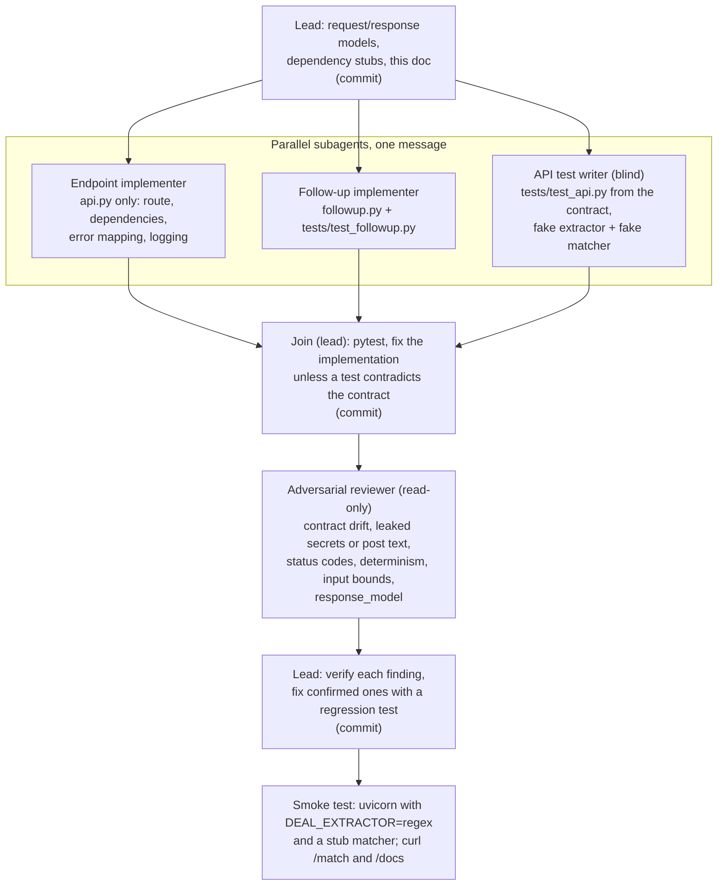

# Agent graph: P9 `POST /match`

How phase P9 (the HTTP API) was built. One lead session, three parallel subagents, one
read-only reviewer. The work lives on branch `p9-api`; `matcher.py` is built on another branch,
so the API depends on it only through a lazily imported dependency.

## Why this shape

- **The test writer is blind to `api.py`.** It works only from the API contract, so its tests
  check the contract rather than restating the implementation. When a test fails at the join,
  the implementation is fixed unless the test contradicts the contract.
- **Disjoint files per agent.** Each parallel agent owns its files, so there are no merge
  conflicts and each commit stays single-purpose.
- **The reviewer can't edit.** Its findings are claims. The lead verifies each one and fixes only
  confirmed ones, each with a regression test.

## Contract the agents shared

- `POST /match`, body `{"text": str}`, 1–4000 characters after stripping; otherwise 422.
- 200: `{extractor, requirement, matches[{broker_id, name, source, license_number, license_type,
  score, reasons}], excluded_for_licensing, follow_up_question}`.
- `ExtractionError` → 422; any `anthropic.APIError` → 503 "extraction service unavailable",
  never echoing upstream text.
- Never log the post text; log a SHA-256 prefix and the length.
- Dependencies to override in tests: `get_extractor`, `get_brokers`, `get_as_of`, `get_matcher`.
