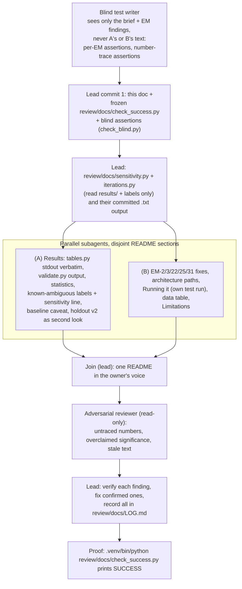

# Agent graph: docs pass (README v1)

How the README was brought in line with the final eval. One lead session on branch `docs-v1`,
a blind test writer, two parallel section writers, one read-only adversarial reviewer. No API
calls, and no change to code, data, tests or `results/`.

## Why this shape

- **The check is frozen first.** `check_success.py` and `check_blind.py` land in commit 1 and are
  never edited after; check (j) enforces that. So the bar can't move to fit the README.
- **The test writer is blind.** It sees only the brief and the EM findings, so its assertions
  check what the README promises, not what A or B happened to write.
- **Generated, not typed.** Every table and statistic block in the README is pasted from a
  command the check re-runs (`tables.py`, `validate.py`, `sensitivity.py`, `iterations.py`,
  pytest). A hand-edited number fails the check.
- **The reviewer can't edit.** Its findings are claims; the lead verifies each before fixing.

## Owned files

`README.md`, this doc, and `review/docs/**`. Nothing else may differ from `main` (check (a), (i)).

## Contract for the README (shared by A, B and the blind test writer)

- The verbatim stdout of
  `.venv/bin/python tools/final_eval/tables.py results/regex_20261026T003559Z.json results/claude_20261026T003610Z.json --holdout-v2 results/claude_20261024T234359Z.json results/regex_20261024T224817Z.json`
  appears in the README, split at its `### ` headings: each chunk verbatim, in order, so prose may
  sit between the v3 table and the v2 table.
- The full stdout of `validate.py` for both final files appears verbatim (in fenced blocks).
- `review/docs/sensitivity.txt` (the output of `review/docs/sensitivity.py`) appears verbatim.
- `review/docs/iterations.txt` (the output of `review/docs/iterations.py`: per-iteration dev means,
  per-run min–max, paired exact McNemar vs the previous kept prompt, and first vs final prompt on the
  11 untuned posts) appears verbatim and replaces the hand-typed iteration numbers (EM-3).
- The test count is written as `<passed> passed, <skipped> skipped` and must equal the check's own
  pytest run.
