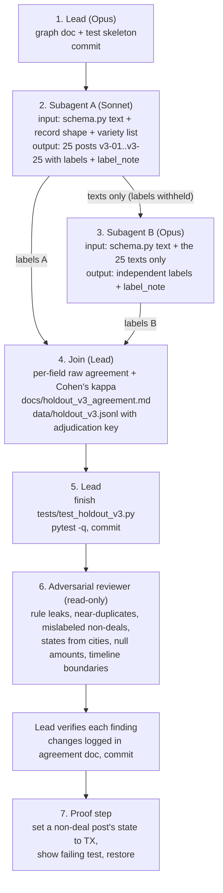

# Agent graph: holdout v3

Holdout v3 is a fresh, double-labeled evaluation set. Its purpose is independence:
the dev set, holdout v2 and the extractor prompt were all written by Claude, so they
may share blind spots. This set is written and labeled without anyone seeing them.

## Isolation rule

Until labels are final, no agent in this graph reads `extractors/`, `data/posts.jsonl`,
`data/holdout.jsonl` (beyond the first line's keys, for the record shape), `results/`,
`loop/`, `README.md`, `HANDOFF.md` or any test file. No extractor is run on this set.
The only rule source is `schema.py`.

## Graph

## Who sees what

| Agent | Sees | Never sees |
|---|---|---|
| A (Sonnet) | `schema.py` text, record shape, variety list | any existing data, extractor, results |
| B (Opus) | `schema.py` text, A's 25 texts | A's labels and notes, any existing data |
| Join (lead) | A and B outputs | extractors, results (until labels final) |
| Reviewer | final `data/holdout_v3.jsonl`, `schema.py`, agreement doc | extractors, other data files |

Disagreements are not resolved silently: each record carries `"adjudication":
"agreed" | "lead-resolved"`, and the agreement doc lists every disagreement with the
schema rule the lead used, so the owner can overrule.
