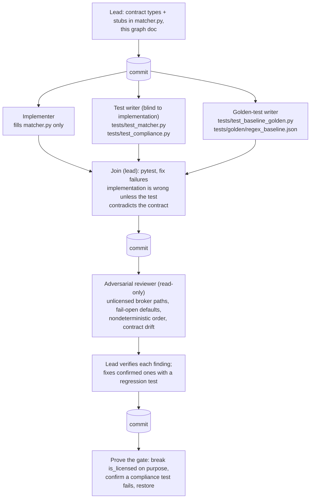

# Agent graph: broker matcher (P7) and compliance tests (P8)

The matcher's one non-negotiable property is that it never returns a broker who
isn't verifiably licensed in the deal's state. The graph is built around that:
the tests are written blind to the implementation, from the contract alone, so
they check the rules rather than restate the code.



## Roles

| Agent | Writes | Reads | Why it's separate |
|---|---|---|---|
| Lead | `matcher.py` stubs, this doc, fixes | everything | Owns the contract and every commit |
| Implementer | `matcher.py` | contract, `brokers.py`, `schema.py` | One file, one job |
| Test writer | `tests/test_matcher.py`, `tests/test_compliance.py` | contract, data files | Blind to the code, so a shared misreading can't pass both |
| Golden-test writer | `tests/test_baseline_golden.py`, `tests/golden/` | `extractors/regex_baseline.py`, data files | Pins the frozen baseline so CI catches any drift |
| Reviewer | nothing | everything | Looks for ways the gate fails open |

## Contract

```python
def is_licensed(broker: Broker, state: str | None, as_of: date) -> bool
def match(req: DealRequirement, brokers: list[Broker], as_of: date, limit: int = 5) -> MatchResult
```

`is_licensed` is true only when the state is known and equals the broker's
license state, the status is exactly `Active`, and the expiration is known and
on or after `as_of`. Anything unknown counts as not licensed. This is a
conservative product rule, not a legal judgment.
