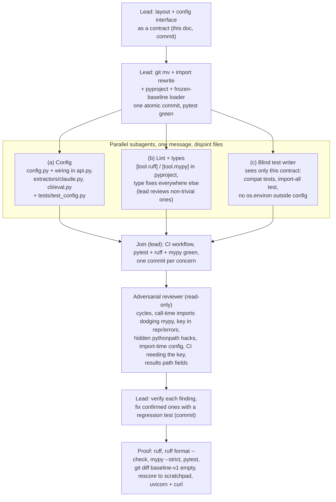

# Agent graph: P10 packaging

How phase P10 (one importable package, one config module, lint/type gates, CI) was built. One
lead session, three parallel subagents, one read-only reviewer, on branch `p10-packaging`. It is
the only builder in its wave because it touches every file.



## Why this shape

- **The move is one commit.** Renames plus import rewrites are mechanical and only make sense
  together: any split leaves a commit where nothing imports.
- **Disjoint files per agent.** (a) owns the three files that read the environment, so (b) never
  edits them; at the join the lead fixes any type or lint leftovers in (a)'s files.
- **The test writer is blind.** (c) sees only this contract, so its tests check the promises
  below rather than restating the implementation.
- **The reviewer can't edit.** Its findings are claims; the lead verifies each one and fixes only
  confirmed ones, each with a regression test.

## Contract

### Layout

```
pyproject.toml                      build (setuptools), pinned deps, console scripts, pytest/ruff/mypy config
deal_board/__init__.py              docstring only; imports nothing (no import-time side effects)
deal_board/paths.py                 REPO_ROOT, DATA_DIR, RESULTS_DIR
deal_board/config.py                Settings, load_settings(), load_dotenv_file()  (the ONLY env reader)
deal_board/schema.py                (was schema.py)
deal_board/scoring.py               (was scoring.py)
deal_board/matcher.py               (was matcher.py)
deal_board/followup.py              (was followup.py)
deal_board/brokers.py               (was brokers.py)
deal_board/api.py                   (was api.py)       uvicorn deal_board.api:app
deal_board/extractors/__init__.py   (was extractors/__init__.py)  Extractor, ExtractionError, parse_requirement
deal_board/extractors/claude.py     (was extractors/claude.py)
deal_board/extractors/regex_baseline.py         typed loader exposing RegexExtractor (new file)
deal_board/extractors/frozen/regex_baseline.py  (was extractors/regex_baseline.py) byte-identical to baseline-v1
deal_board/cli/__init__.py
deal_board/cli/eval.py              (was scripts/eval.py)    python -m deal_board.cli.eval | deal-eval
deal_board/cli/build_brokers.py     (was scripts/build_brokers.py)  python -m deal_board.cli.build_brokers | deal-build-brokers
loop/check_success.py               stays (historical script): python loop/check_success.py --stage dev
tests/                              stays; tests/golden/ unchanged
data/, results/, docs/              stay at the repo root
```

- The package must be installed (`pip install -e '.[dev]'`). There is no `pythonpath` setting,
  no `sys.path` edit anywhere, and pytest runs with `--import-mode=importlib`, so a test passes
  only if `deal_board` is importable as an installed package.
- `paths.REPO_ROOT` is the repository root (the parent of `deal_board/`). Data and results live
  outside the package, so the package is meant for an editable install from a checkout.
- Results files store dataset paths relative to the repo root (`data/holdout.jsonl`); those paths
  are unchanged, so every file in `results/` still rescores.
- `frozen/` has no `__init__.py`, so the frozen file can't be imported by accident. Its source
  says `from schema import ...` and may not be edited, so `regex_baseline.py` executes it with a
  scoped `__import__` that maps exactly `schema` to `deal_board.schema`, and wraps the class in a
  typed `RegexExtractor` (`name == "regex"`, `extract(text: str) -> DealRequirement`). Ruff and
  mypy exclude `frozen/`.
- `extractors.claude.PROMPT_VERSION` stays `ac1a145b` (the move must not change the prompt or tool).

### Config module (`deal_board/config.py`)

```python
DEFAULT_MODEL: Final = "claude-haiku-5-5"
DOTENV_PATH: Final[Path]            # paths.REPO_ROOT / ".env"

@dataclass(frozen=True)
class Settings:
    anthropic_api_key: pydantic.SecretStr | None = None  # ANTHROPIC_API_KEY; unset or "" -> None
    deal_extractor: str = ""             # DEAL_EXTRACTOR, stripped + lowercased; only "regex" means anything
    deal_model: str = DEFAULT_MODEL      # DEAL_MODEL; unset or "" -> DEFAULT_MODEL

    has_api_key: bool                    # property
    use_claude: bool                     # property: has_api_key and deal_extractor != "regex"
    def api_key_value(self) -> str | None: ...  # the only way to the plaintext; for the Anthropic client

def load_settings(environ: Mapping[str, str] | None = None) -> Settings: ...
    # Reads os.environ (or `environ`) at CALL time; nothing reads the environment at import time.
def load_dotenv_file(path: Path = DOTENV_PATH) -> bool: ...
    # python-dotenv, override=False (a key set in the shell wins). Called only from CLI entry points.
```

- No module other than `deal_board/config.py` touches `os.environ`, `os.getenv` or dotenv.
  Tests may use `monkeypatch.setenv/delenv`.
- The key never appears in `repr()`, `str()`, `format()`, log records, or exception messages of
  `Settings`; `SecretStr` renders as `**********`.
- `api.get_extractor()`: Claude iff `load_settings().use_claude`, else regex (unchanged behavior).
  The Anthropic clients get `api_key=settings.api_key_value()` explicitly.
- `ClaudeExtractor(client=None, model=None)`: model defaults to `load_settings().deal_model`.
- `cli/eval.py`: `main(argv)` never loads `.env` (tests call it); `run()` = `load_dotenv_file()`
  then `main()`, used by `deal-eval` and `python -m deal_board.cli.eval`. Without a key, Claude
  is skipped with the existing NOTE.

### Tooling

- Ruff 0.17.2, mypy 2.4.0, pinned in the `dev` extra. Line length 120. Rules: `E W F I B UP SIM
  C4 RUF` (pycodestyle, pyflakes, isort, bugbear, pyupgrade, simplify, comprehensions, ruff's
  own), with `E501` left to the formatter and `RUF001-003` off because en dashes and `±` in
  output strings are intentional.
- `mypy --strict deal_board loop tests` clean. No bare `# type: ignore`; any ignore names its
  error code and gives a reason. No `Any` added just to silence an error.
- CI (`.github/workflows/ci.yml`): on push and pull_request, install, `ruff check`,
  `ruff format --check`, `mypy --strict`, `pytest -q`, with no `ANTHROPIC_API_KEY` and no network
  beyond `pip install`. Checkout uses full history so the `baseline-v1` tag exists for the frozen
  file check.

### Compatibility that tests must prove

1. Every `results/*.json` parses; every eval-run file (has `datasets`) rescores offline with
   `deal_board.cli.eval.rescore`, and every dataset `path` in it exists under `REPO_ROOT`. Every
   `results/*.md` reads as UTF-8.
2. `python -m deal_board.cli.eval --rescore results/claude_20261024T234359Z.json --results-dir <tmp>`
   exits 0 with no `ANTHROPIC_API_KEY`, writes one `.json` + `.md` into `<tmp>`, and leaves
   `results/` byte-for-byte unchanged (same names, same contents).
3. `tests/test_baseline_golden.py` passes unchanged in substance.
4. `git show baseline-v1:extractors/regex_baseline.py` equals the bytes of
   `deal_board/extractors/frozen/regex_baseline.py`.
5. `loop/check_success.py` runs as a script; its protected paths exist in the new layout. (Its
   guard runs the whole pytest suite, so tests must not call `guard_checks()` or `main()`.)
6. `uvicorn.importer.import_from_string("deal_board.api:app")` resolves to the FastAPI app.
7. Every module under `deal_board` imports; `frozen/` is not importable as a package.
