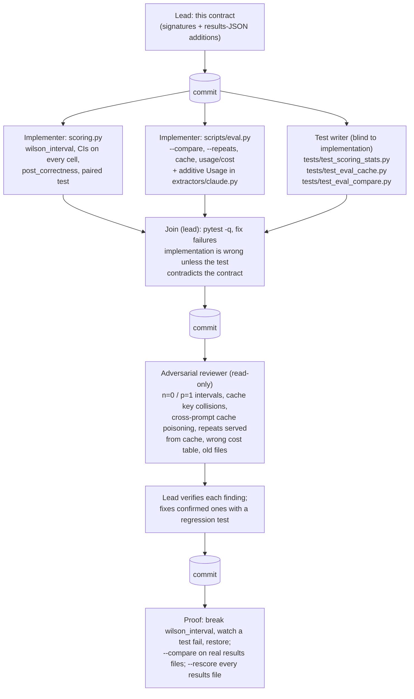

# Agent graph: eval statistics (P6)

With 15 holdout posts and 24 dev posts, a one-post change moves accuracy by
4–7 points. P6 makes that visible: every accuracy gets a Wilson interval, two
runs can be compared post by post with an exact test, `--repeats` measures
run-to-run variance, and every run records what it cost. The tests are written
blind to the implementation, from this contract alone, so a shared misreading
can't pass both.



## Roles

| Agent | Writes | Reads | Why it's separate |
|---|---|---|---|
| Lead | this doc, `.gitignore`, fixes | everything | Owns the contract and every commit |
| Scoring implementer | `scoring.py` | contract, `schema.py`, tests | Pure statistics, no I/O |
| Eval implementer | `scripts/eval.py`, minimal additive change to `extractors/claude.py` | contract, `scoring.py` contract | CLI, cache and provenance |
| Test writer | `tests/test_scoring_stats.py`, `tests/test_eval_cache.py`, `tests/test_eval_compare.py` | this contract, `results/*.json`, `data/`, existing tests | Blind to the code |
| Reviewer | nothing | everything | Hunts for silent statistical and caching errors |

## Contract

### scoring.py

```python
Z_95: float = 1.96

def wilson_interval(successes: int, n: int, z: float = Z_95) -> tuple[float, float]
```
Wilson score interval for a binomial proportion. Why Wilson and not the normal
(Wald) interval: at n = 15 and accuracy near 100% the Wald interval collapses
to zero width or leaves [0, 1]; Wilson stays inside [0, 1] and keeps sensible
width. Rules:
- `n == 0` returns `(0.0, 1.0)`: with no data every rate is plausible.
- `successes < 0`, `n < 0` or `successes > n` raise `ValueError`.
- `successes == 0` gives a lower bound of exactly `0.0`; `successes == n`
  gives an upper bound of exactly `1.0` (no float drift such as 0.9999999).
- Reference values (z = 1.96): `(0, 10) → (0.0, 0.2775)`, `(10, 10) → (0.7225, 1.0)`,
  `(5, 10) → (0.2366, 0.7634)`, `(14, 15) → (0.7018, 0.9881)`, `(1, 1) → (0.2065, 1.0)`
  (4 decimal places).

```python
def exact_mcnemar_p(b_only: int, a_only: int) -> float
```
Two-sided exact McNemar test, which is the exact binomial sign test on the
discordant pairs: under H0 each discordant post is equally likely to favor
A or B, so `p = min(1, 2 * P(X <= min(b_only, a_only)))` with
`X ~ Binomial(b_only + a_only, 0.5)`. `b_only == a_only == 0` returns `1.0`.
Why exact and not chi-square McNemar: discordant counts here are 0–10, far
below the ~25 where the chi-square approximation holds. Why paired at all:
both runs score the same posts, so an unpaired test of two proportions would
ignore that most posts are right (or wrong) in both. Standard library only
(`math.comb`). Negative inputs raise `ValueError`. Reference values:
`(5, 0) → 0.0625`, `(0, 5) → 0.0625`, `(3, 1) → 0.625`, `(0, 0) → 1.0`, `(1, 1) → 1.0`.

```python
SCORED_FIELDS: tuple[str, ...] = ("is_deal_request", *KEY_FIELDS, "missing_fields")

def post_correctness(posts: list[dict], records: dict[str, dict]) -> dict[str, dict[str, bool]]
```
Maps each name in `SCORED_FIELDS` to `{post_id: correct}` for exactly the
posts on which that field is scored by `score()`: `is_deal_request` on every
post, the key fields and `missing_fields` only on posts labeled as deal
requests. A field is correct when its `score()` outcome is `correct` or
`correct_missing`; an errored record is incorrect on every field it is scored
on. For any posts/records, the count of `True` values per field equals the
numerator of that field's accuracy in `score()`.

```python
def paired_comparison(a: dict[str, bool], b: dict[str, bool]) -> dict
```
Compares two `{post_id: correct}` maps on the post ids present in both.
Returns `{"n": int, "a_correct": int, "b_correct": int, "b_only": [ids],
"a_only": [ids], "p_value": float}`, where `b_only` lists posts B got right
and A got wrong (sorted), `a_only` the reverse, `p_value =
exact_mcnemar_p(len(b_only), len(a_only))`.

### score() output additions (keys only added; nothing removed or renamed)

- Every cell that has `accuracy` (`is_deal_request`, each `fields[f]`,
  `missing_fields`) gains `"ci95": [lo, hi]`, the Wilson interval of
  `accuracy`'s numerator over its denominator, or `None` when the denominator
  is 0 (matching `accuracy: None`).
- Each `fields[f]` also gains `"hallucination_rate"` (= `hallucinated / n_deal_posts`,
  `None` if 0) and `"hallucination_ci95"` (Wilson, `None` if 0).
- `non_deal_hallucinations` gains `"posts_with_any_rate"` (= `posts_with_any /
  n_non_deal_posts`) and `"posts_with_any_ci95"`, both `None` when there are
  no non-deal posts.

No mean accuracy is reported, so none gets an interval.

### extractors/claude.py (additive only)

```python
@dataclass(frozen=True)
class Usage:
    input_tokens: int
    output_tokens: int

ClaudeExtractor.last_usage: Usage | None
```
Set by every `extract_raw` call from `response.usage` (also when the call then
raises `ExtractionError` for a refusal, since refused calls still bill);
reset to `None` at the start of each call, and `None` when the response has
no `usage` (fake clients). `extract(text) -> DealRequirement` is unchanged.

### scripts/eval.py

```python
PRICES_PER_MTOK: dict[str, tuple[float, float]]   # model -> (input $, output $) per 1M tokens
def cost_usd(model: str | None, input_tokens: int, output_tokens: int) -> float | None
```
`cost_usd` returns `0.0` when both token counts are 0 (nothing was billed,
e.g. regex or a fully cached run), and `None` when tokens are non-zero but the
model is not in the table. It never guesses a price.

```python
def cache_key(model: str, prompt_version: str, text: str) -> str

class RawCache:
    def __init__(self, directory: Path, model: str, prompt_version: str) -> None
    def get(self, text: str) -> dict | None
    def put(self, text: str, entry: dict) -> None
```
- `cache_key` is the sha256 hex digest of `json.dumps([model, prompt_version,
  sha256(text).hexdigest()])`; the file is `<directory>/<key>.json`, so no part
  of a model name becomes a path.
- An entry is `{"model", "prompt_version", "text_sha256", "raw": dict | None,
  "error": str | None, "input_tokens": int | None, "output_tokens": int | None,
  "latency_s": float | None}`. `get` returns `None` (a miss) when the file is
  missing, is not valid JSON, or its `model`/`prompt_version`/`text_sha256`
  don't equal the requested ones. Extraction errors (refusal, no tool call)
  are cached like successes, so a resumed run replays the same outcomes
  instead of re-rolling only the failures. API/network exceptions are never
  cached (they propagate, as today).
- **Repeats rule: one `RawCache` instance serves each key from disk at most
  once.** The CLI creates one instance per invocation and shares it across all
  repeats and datasets, so with `--repeats 3` run 1 may replay cached outputs
  (resuming an earlier interrupted invocation), and runs 2 and 3 always call
  the API. Every fresh call is written back (latest wins). This keeps the
  cache resumable while guaranteeing that repeats within one invocation are
  independent samples.
- `put` writes atomically (temp file + `os.replace`), so a crash never leaves
  a half-written entry. Default directory: `ROOT/.cache/extractor/` (git-ignored).

```python
def run_posts(extractor, posts: list[dict], cache: RawCache | None = None) -> dict[str, dict]
def evaluate(extractor, split: str = "all", cache: RawCache | None = None) -> dict
```
Each record gains `"call": {"cached": bool, "input_tokens": int | None,
"output_tokens": int | None, "latency_s": float | None}`. On a fresh call
latency is wall-clock (`time.perf_counter`) around the extractor call and
tokens come from `extractor.last_usage` (None for regex). On a cache hit the
values are the original call's, read from the entry, and `cached` is True.
The cache is consulted only when `cache` is given; the regex baseline never
gets one.

```python
def usage_totals(datasets: dict, model: str | None) -> dict
```
Top-level `"usage"` in every new results JSON: `{"api_calls": int,
"cache_hits": int, "input_tokens": int, "output_tokens": int, "cost_usd":
float | None, "latency_s_total": float, "latency_s_mean": float | None,
"price_per_mtok": [in, out] | None, "prices_as_of": str}`. Tokens, cost and
latency count only calls made in this run (`cached == False`); a cache hit
cost nothing now. `api_calls` = records with `cached == False` and a non-None
`input_tokens` (so regex reports 0); `cache_hits` = records with `cached ==
True`. Latency totals cover all fresh calls (regex included). Records without
a `call` key (old files) are skipped.

New results JSON keys, all additive: `"usage"` (above), `"repeat": {"index":
k, "of": N}` (1-based; `{"index": 1, "of": 1}` without `--repeats`), and
`"cache_enabled": bool`. `save()` never overwrites an existing file: if the
stem is taken it appends `-2`, `-3`, ... With `--repeats N > 1` the stem is
`<extractor>_<timestamp>_r<k>`.

```python
def summarize_repeats(results: list[dict]) -> dict[str, dict[str, dict]]
```
`{dataset_name: {field: {"mean": float | None, "min": float | None, "max":
float | None, "runs": int}}}` for every field in `SCORED_FIELDS`, over runs
whose accuracy is not None. Printed after the last repeat as a table, e.g.
`state  mean 91%  min–max 87–96%  (3 runs)`.

```python
def compare_results(a: dict, b: dict) -> dict
def format_comparison(cmp: dict, a_name: str, b_name: str) -> str
```
Re-scores both saved runs from their raw outputs against the current labels
(no API calls; same labels for both, so a label fix can't masquerade as a
model change). Datasets are matched by `path` (so a dev-split run named
`posts_dev` compares with a full run's `posts`), and only post ids present in
both runs are compared. Returns `{path: {"n_common_posts": int, "fields":
{field: paired_comparison(...)}}}` for each common path, fields in
`SCORED_FIELDS` order. Output names the McNemar test and lists the ids.

### CLI

```
python scripts/eval.py --extractor regex                 # unchanged behaviour (+ new keys)
python scripts/eval.py --rescore results/X.json           # unchanged; works on every eval run file
python scripts/eval.py --compare A.json B.json            # prints; writes nothing
python scripts/eval.py --extractor claude --repeats 3     # 3 results files + summary
python scripts/eval.py --extractor claude --no-cache      # bypass the cache entirely
python scripts/eval.py ... --results-dir DIR              # where results are written (default results/)
python scripts/eval.py ... --cache-dir DIR                # default .cache/extractor/
```
`--rescore` and `--compare` on a JSON that has no `datasets` key (e.g.
`results/baseline-v1_comparison.json`, a summary, not an eval run) exit with
status 2 and a one-line message saying so, instead of a traceback.
`--repeats` must be >= 1. Old results files (no `ci95`, `usage`, `call`)
load, rescore and compare; markdown omits the usage line when `usage` is absent.

### Markdown additions

- Accuracy cell: `92% [64–99]` (Wilson bounds as whole percents), `n/a` when None.
- A `halluc. rate` column for key fields (`7% [1–30]`), `–` for the other rows.
- The hallucinations line adds the non-deal rate and its interval.
- A `**Usage:**` line: calls, cache hits, input/output tokens, cost (or
  `unknown (model not in price table)`), total and mean latency.
