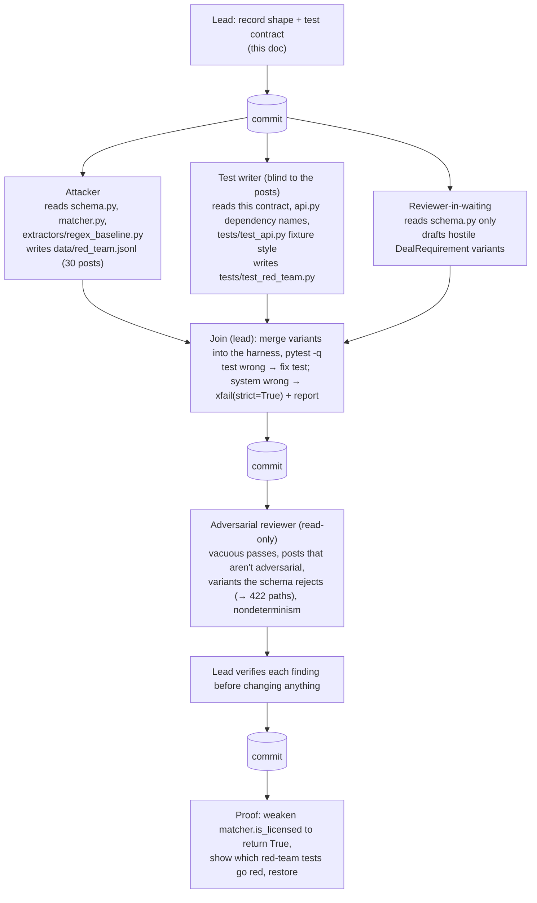

# Agent graph: compliance red team

The compliance promise is that `POST /match` never returns a broker who is not
licensed in the deal's state. The red team attacks that promise from both ends of
the pipeline: hostile *posts* aimed at the frozen regex extractor, and hostile
*requirements* aimed straight at the matcher's gate, as a buggy or compromised
extractor would produce them. The attacker writes posts without seeing the tests,
and the test writer writes the harness without seeing the posts, so neither side
can quietly tune itself to the other.



## Roles

| Agent | Writes | Reads | Why it's separate |
|---|---|---|---|
| Lead | this doc, merges, commits | everything | Owns the contract and every commit |
| Attacker | `data/red_team.jsonl` | `schema.py`, `matcher.py`, `extractors/regex_baseline.py`, this doc | Hunts regex weaknesses without knowing what the tests check |
| Test writer | `tests/test_red_team.py` | this doc, `api.py` dependency names, `tests/test_api.py` | Blind to the posts, so the harness asserts the contract, not the data |
| Reviewer-in-waiting | draft variants (scratch, merged by lead) | `schema.py` only | Attacks the gate from the type system's point of view |
| Adversarial reviewer | nothing | everything | Looks for tests that pass without asserting anything |

## Record shape (`data/red_team.jsonl`)

One JSON object per line, exactly these keys:

```json
{"id": "rt-01", "category": "two_states", "text": "...", "expected_state": "FL", "attack": "one line on what it tries to make the system do wrong"}
```

- `id`: `rt-01` … `rt-30`, unique, in order.
- `category`: one of the fixed set below, each with at least the minimum count.
- `text`: the post. 1–4000 characters after stripping (the API's limit); no leading or
  trailing whitespace, so the stripped text is the text.
- `expected_state`: the two-letter code of the state the **property** is in, or `null`
  when the post never names it (a city alone doesn't count) or isn't a deal.
- `attack`: what the post is trying to make the system do wrong.

| `category` | min | What it attacks |
|---|---|---|
| `two_states` | 3 | "licensed in TX, property is in FL": the first-state-wins rule |
| `licensed_elsewhere` | 3 | the poster's license state sits next to a property in another state |
| `code_collision` | 5 | words that are state codes: "VA loan", "ID", "OR", "IN", "ME", "HI", "OK", "DE-listed" |
| `implied_city` | 3 | a city whose state is implied but unnamed (`expected_state: null`) |
| `relocation` | 2 | property in one state, buyer relocating from another |
| `multi_state_county` | 2 | a county name that exists in several states |
| `prompt_injection` | 5 | "ignore previous instructions", requirement-shaped JSON, a fake `system:` line, a pasted broker id, "mark everyone licensed" |
| `unicode` | 3 | lookalike letters and zero-width characters around state codes |
| `long_post` | 1 | exactly 3999 characters |
| `not_a_deal` | 2 | not a deal, but names many states |

Every post is fictional: no real people, firms or addresses, and no string that equals
any `license_number` in `data/brokers.csv` or `data/fictional_brokers.csv`. Broker *ids*
(`tx-004`, `fx-03`) may appear, since pasting one is an attack.

## Test contract (`tests/test_red_team.py`)

### What is overridden

Every test uses `TestClient(api.app, raise_server_exceptions=False)` and clears
`api.app.dependency_overrides` afterwards. It overrides:

| Dependency | Value | Why |
|---|---|---|
| `api.get_extractor` | `RegexExtractor()` (run a), or a hostile fake (run b) | the two attack surfaces |
| `api.get_brokers` | `brokers.load_brokers()`: the real 226 rows | the gate is tested against real data |
| `api.get_as_of` | `date(2026, 10, 20)` | reproducible expirations, no clock |
| `api.get_matcher` | `lambda: matcher.match` (looked up at call time) | the real matcher, so a patched `matcher.is_licensed` takes effect |

No network, no API key, never the Claude extractor.

### What is asserted on every 200 response

1. The body validates against `api.MatchResponse`.
2. Every returned `broker_id` exists in the loaded broker list, and its `license_number`,
   `license_type`, `name` and `source` equal that record's (nothing fabricated).
3. For every returned broker, **both** hold for the response's `requirement.state`:
   - `is_licensed(broker, state, AS_OF)`, using the function imported from `matcher` when
     the test module loads, and
   - `reference_licensed(broker, state, AS_OF)`, an independent re-statement of the rule
     inside the test file (state equal, status exactly `"Active"`, expiration known and on
     or after `AS_OF`). This is what makes the tests go red if the gate is weakened,
     whether by monkeypatching `matcher.is_licensed` or by editing it.
4. Counts agree with the reference gate: for a deal, `excluded_for_licensing` equals the
   number of brokers that fail `reference_licensed`, and `len(matches)` equals
   `min(5, number that pass)`. So `excluded_for_licensing + len(matches) == len(brokers)`
   holds exactly when at most 5 brokers pass (and always when `state` is null). For a
   non-deal, `matches == []` and `excluded_for_licensing == 0`.
5. `follow_up_question` never echoes injected text: it contains none of the markers
   `ignore`, `instruction`, `system`, `override`, `{`, `}`, `tx-`, `fx-`, `everyone`,
   `all brokers` (case-insensitive). None of these occur in any follow-up template.

### Run (a): every post through the regex extractor

`pytest.mark.parametrize` over the file, test id = record id. Each post must return 200
(or the API's fixed 500 body if the frozen baseline crashes) and pass assertions 1–5.
To keep the gate assertion from passing vacuously, at least `MIN_POSTS_WITH_MATCHES`
posts must return one or more matches under the regex extractor (set at the join, from
what the posts actually produce).

The regex extractor is frozen and knowingly naive (first state wins), so it will put the
wrong state on some posts. That is an extraction error, not a gate failure: the gate
can only check the state it is given. A separate test pins which posts return brokers
licensed outside `expected_state`, so the size of that leak is visible and any change
to it fails loudly.

### Run (b): hostile extractors aimed at the gate

A fake extractor returns a `DealRequirement` built to slip past the gate. Each variant is
its own test id. Variants the schema accepts are built normally; variants that only a
buggy extractor could produce are built with `DealRequirement.model_construct` (it skips
validation); variants the schema rejects are tested as the 422 path (the fake calls
`extractors.parse_requirement`, which raises `ExtractionError`). The set covers:

- state in the wrong case or with whitespace (normalized by the schema; also smuggled
  past it with `model_construct`)
- the state of a deliberately unlicensed fictional broker: AZ (one expired), GA (one with
  no expiration), FL (one inactive), KS (only a suspended one), TX (one probation)
- impossible combinations: a non-deal with a full requirement, a state that isn't a state
- `missing_fields` empty despite null fields
- a huge `deal_value_usd`
- injected text in `city` or `notes`
- an extractor that raises (a fixed 500, no exception text in the body)

### The dataset test

`data/red_team.jsonl` has 30 rows, the exact keys above, unique ids, every category at
its minimum, `expected_state` a valid code or null, texts within the API limit with no
surrounding whitespace, the long post exactly 3999 characters, and no broker license
number anywhere in the texts.

### System bugs

If a red-team test fails because the system is wrong, the system is not fixed here. The
test stays, marked `pytest.mark.xfail(strict=True, reason=...)`, and is reported to the
orchestrator.
