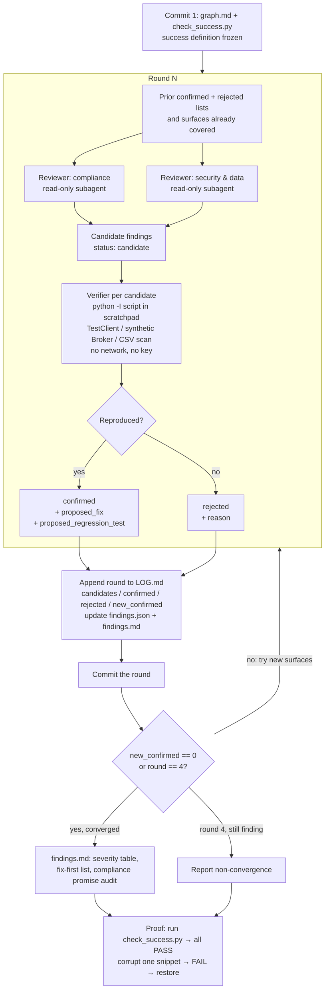

# Compliance & security review loop

Read-only adversarial review of the deal board over two dimensions: **compliance** (can an
unverifiable broker ever be returned or ranked?) and **security & data** (secrets, logs, leaks,
PII, injection, DoS). No existing file is changed; every claim is reproduced before it counts.
Success is defined once, in `check_success.py`, and that file is frozen after the first commit.

Rules the loop never breaks: no edits outside `review/compliance-security/`, nothing in
`results/` touched, `.env` never opened, no API calls, no scraping, no pushes or merges.
