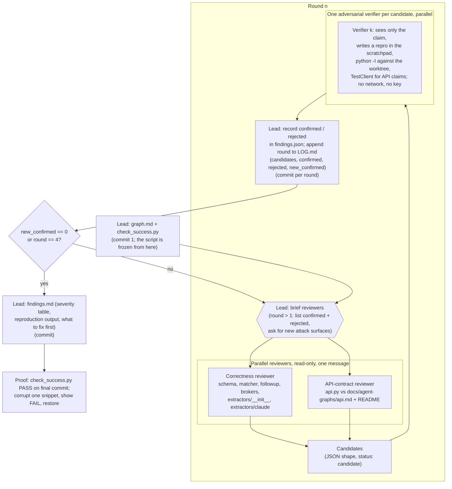

# Agent graph: correctness and API-contract review loop

A read-only review of `schema.py`, `matcher.py`, `followup.py`, `brokers.py`,
`extractors/__init__.py`, `extractors/claude.py` (correctness) and `api.py` against
`docs/agent-graphs/api.md` and `README.md` (API contract). The loop produces findings, not
fixes: no existing file changes. Branch `review-correctness-api`, cut from `main` at `c4ae4be`.

## Why this shape

- **Success is defined before any reviewing.** `check_success.py` is committed first and never
  edited; its check (e) fails if it changes, so the bar can't drift to fit the results.
- **Reviewers and verifiers are separate agents.** A reviewer's claim is only a candidate. A
  verifier that has seen nothing but the claim must reproduce it with a script before it counts,
  so plausible-sounding but wrong findings are rejected rather than reported.
- **Findings are pinned to code.** Each confirmed finding quotes a snippet that check (b) finds
  within three lines of the cited line, so a finding can't describe code that isn't there.
- **Read-only throughout.** Reviewers and verifiers write only to the scratchpad; the branch adds
  only `review/correctness-api/`, which check (d) enforces. Check (f) shows the suite is untouched.
- **Rounds hunt different surfaces.** After round 1, reviewers are told what was already found or
  rejected and pushed to boundaries (expiration == as_of, leap days, empty broker lists, limits,
  unicode cities, the 4000-char bound, response_model leakage). The loop stops at a round with no
  new confirmed findings, or after four rounds as non-convergence.
