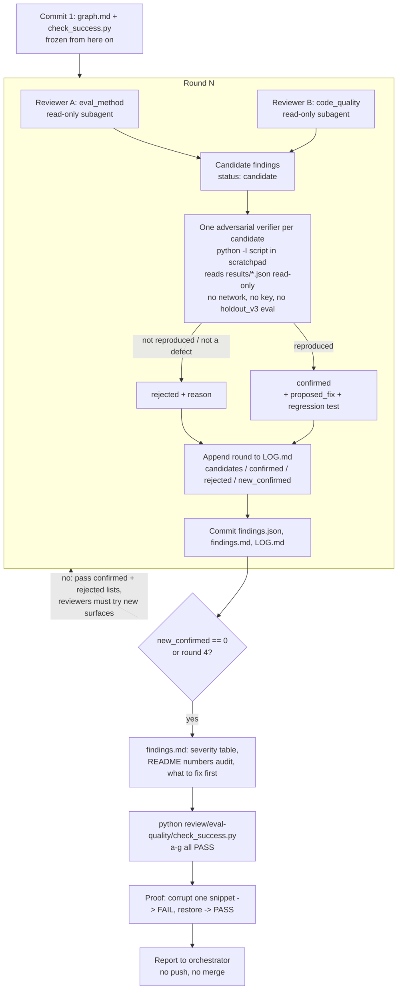

# Review loop: eval method + code quality

Read-only adversarial review of branch `review-eval-quality`. Nothing outside `review/eval-quality/`
changes; `check_success.py` (committed first, then frozen) is the single definition of done.

Round 4 without a zero round is reported as non-convergence, not papered over.
