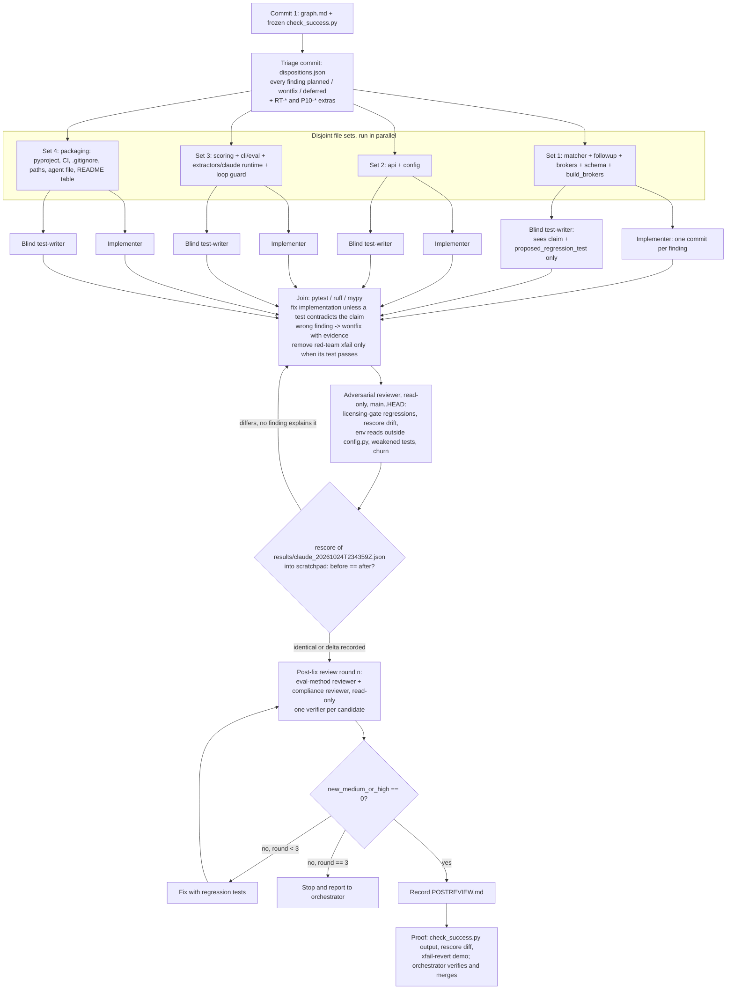

# Fix loop: agent graph

Branch `fix-loop`, cut from `main` at `c47ee1f`. Input: the 59 confirmed findings in
`review/{correctness-api,compliance-security,eval-quality}/findings.json`, plus the 5 red-team strict
xfails (`RT-*`) and the 5 P10 packaging leftovers (`P10-*`). Success is defined once, in
`review/fixes/check_success.py`, committed first and never edited.

Finding ids collide across the three reviews (`C-4` exists in both correctness-api and
compliance-security), so every disposition is keyed by `(review, id)`.

## Rules every node follows

- Never touch `results/`, `data/*.jsonl|csv`, the frozen baseline, `review/` outside `review/fixes/`,
  or the Claude system prompt / tool schema / schema field descriptions (`PROMPT_VERSION` stays `ac1a145b`).
- No `.env`, no API keys, no network calls, nothing evaluated on `data/holdout_v3.jsonl`.
- Small single-purpose commits naming finding ids; typed code; docstrings that say why.
