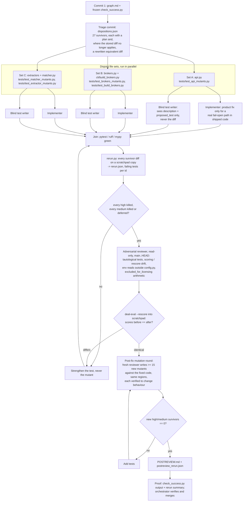

# Fix pass 2: closing the gate-mutant survivors

Branch `fix-pass-2`, cut from `main` at `219f39f`. Input: the 27 high/medium survivors
(`status == "survived"`, `severity` high or medium) in `review/mutants/results.json`: 13 high,
14 medium. Success is defined once, in `review/fixes2/check_success.py`, committed first and
never edited.

A survivor is a deliberate bug the suite did not notice. Closing one means a test that passes
on the shipped code and fails on the mutant. The proof is mechanical: `review/fixes2/rerun.py`
applies each mutant's diff to a scratchpad copy of the current tree, runs the full suite there,
and saves which tests failed in `rerun.json`. Most stored diffs were written against an older
`main` and no longer apply; for those, `dispositions.json` carries a rewritten diff that makes
the same bug in the current code, and the runner uses it.

Owner rules that bound every node: no edits to `results/`, `data/brokers.csv`, `data/*.jsonl`,
`review/mutants/`, `review/fixes/`, `tools/`, `README.md`, `loop/`; the frozen baseline stays
byte-identical to `baseline-v1`; `PROMPT_VERSION` stays `ac1a145b`; no API calls; no `.env`.
After each phase the session checks its context use and writes `HANDOFF.md` above 40%.
