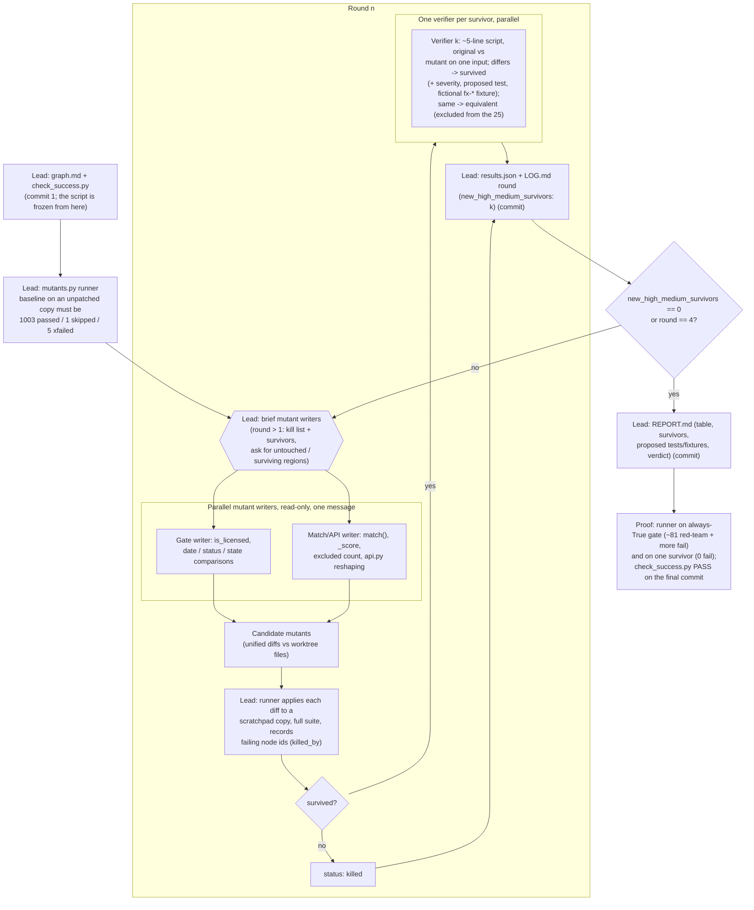

# Agent graph: mutation-testing loop on the licensing gate and match path

Does the test suite actually protect the compliance promise ("never return a broker who can't be
verified as licensed in the deal's state")? We find out by breaking the code on purpose. Each
mutant is a small unified diff to `deal_board/matcher.py`, `deal_board/api.py` or
`deal_board/brokers.py`; a mutant is **killed** when at least one test fails on it and
**survives** when the whole suite stays green.

Mutants are never applied to the worktree. The runner copies the worktree into the scratchpad,
gives each copy its own venv with `pip install -e`, patches the copy, runs the full suite there,
and restores the copy. No existing file in the repo changes; everything lives in `review/mutants/`.
Branch `gate-mutants`, cut from `main` at `c47ee1f`.

## Why this shape

- **Success is defined before any mutant runs.** `check_success.py` is committed first and never
  edited; its check (g) fails if it changes.
- **Mutants are real.** Check (c) re-applies every stored diff to a temp copy of today's file and
  requires the file to change, so a hand-waved or stale mutant fails the check.
- **A survivor needs evidence.** A mutant that passes the suite might just be equivalent to the
  original. A separate verifier must show an input where the two behave differently before the
  survivor counts; otherwise it is marked `equivalent` and doesn't count towards the 25.
- **Severity follows the compliance promise.** `high` = the mutant can return an unlicensed,
  expired or out-of-state broker; `medium` = wrong counts, notes or ranking a client would see;
  `low` = cosmetic or unreachable in practice.
- **Proposals, not edits.** Survivors get a proposed test and, when needed, an obviously
  fictional `fx-*` fixture row. Nothing under `deal_board/`, `tests/` or `data/` is changed,
  because a fix-loop session owns those files.
