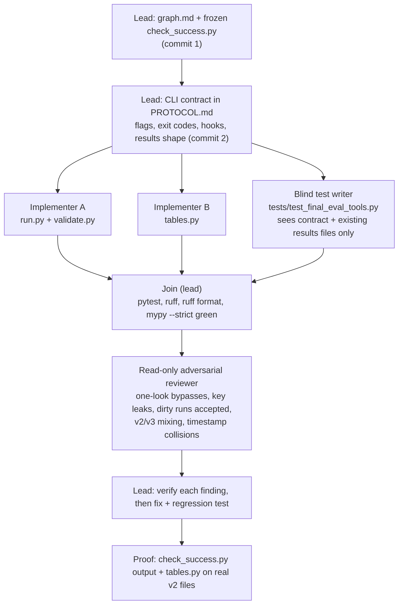

# Agent graph: final-eval protocol tooling (`tools/final_eval/`)

Goal: make the one-shot `holdout_v3` eval mechanical, auditable and blind to its outcome.
Branch `final-eval-tools`, worktree `../deal-requirements-board-final-eval`, cut from `main` at `c47ee1f`.
Success is defined by `check_success.py`, committed here in commit 1 and never edited after.

## Rules every node follows

- Only these paths change: `tools/final_eval/{__init__,run,validate,tables,check_success}.py`,
  `tools/final_eval/{graph,PROTOCOL}.md`, `tests/test_final_eval_tools.py`. No existing file is edited.
- No extractor is ever run on `data/holdout_v3.jsonl`, not even the regex baseline. Tests use a fake
  extractor on synthetic posts in temp dirs. No API calls. `.env` is never opened.
- Nothing under `results/` or `.cache/` is written, edited or deleted.
- The blind test writer never reads `run.py`, `validate.py` or `tables.py`; it tests the contract.
- The reviewer is read-only; each finding is reproduced before it is fixed, and each fix gets a
  regression test.
- The lead never merges or pushes; the orchestrator does, with the owner's approval, and is the one
  who runs the real final eval.
